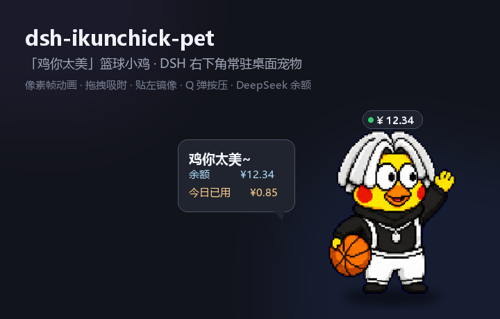
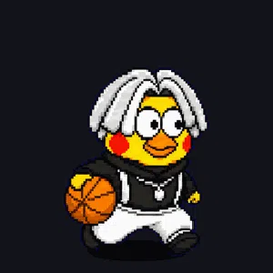
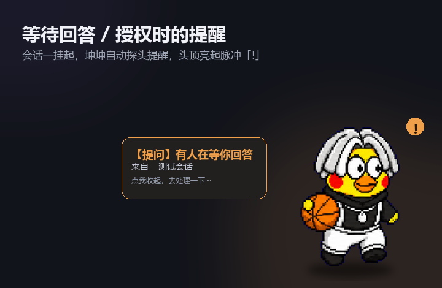

# dsh-ikunchick-pet

English | [中文](README.zh.md)



A **"鸡你太美" basketball-chick desktop pet** for the DeepSeek Harness (DSH) Web GUI. It lives in the
bottom-right corner of the window as a pixel-art sprite, dribbles while the agent is working, waves
when you poke it, dozes off when idle — and doubles as a lightweight DeepSeek balance widget.

Built as a standard DSH bundle plugin: a tiny host half (Cordis plugin + HTTP routes) and a browser
half that renders into the root-scoped `shell.overlay` slot. No build tooling required at install
time; the only "build" step inlines the spritesheet into the client bundle (see [Development](#development)).





## Features

- 🐤 **Always-on corner pet** — mounts into `shell.overlay` (covers the whole frame), draggable
  anywhere, remembers its position across reloads.
- 🏀 **Hand-drawn pixel animations** — idle breathing, **dribbling** (while any session is running),
  **waving** (on click), **celebrating** (when a run finishes) and **resting / sleeping** after a
  spell of inactivity. `image-rendering: pixelated` keeps the pixel art crisp at any size.
- 🧲 **Edge snapping + mirror** — drag near the left/right edge to snap; when snapped left the chick
  horizontally mirrors so it faces the content. Vertical position is clamped to the viewport.
- 🧸 **Q-bounce press** — pressing squashes the sprite with a spring-back transition, optional soft
  "boing" (WebAudio, no audio asset).
- 🔊 **Click sounds** — two built-in clips play on click: **奶龙笑 (Nailong laugh)** and
  **唱跳rap篮球 (Kunkun's line)**; switch or mute from the right-click menu (picking one previews it).
  The clips are synthesized offline with Windows SAPI TTS and baked into the bundle as data URIs —
  nothing to download, and you can drop in your own clips by replacing `assets/click-*.wav` and
  rebuilding.
- 🔔 **Waiting reminders** — when a session is **waiting for you to answer** (`ask_user_question`) or
  **approve an action** (`approval/asked`), the chick pops a reminder bubble (with the session name),
  plays a little attention hop, and shows a pulsing `!` badge until the interaction is resolved. Click
  the bubble to dismiss it; it disappears automatically once you answer/approve.
- 💬 **Speech bubble** — click the chick for a random catchphrase plus, when configured, your
  **DeepSeek balance** and **today's observed spend**. The bubble auto-dismisses.
- 💰 **Balance badge** — a compact `¥` pill above the pet, refreshed every 60s from
  `https://api.deepseek.com/user/balance` via the DSH credentials service (`DEEPSEEK_API_KEY`).
  Missing key / network errors degrade gracefully — the pet still works.
- ⚙️ **Right-click menu** — size (S/M/L), animation speed, press sound, balance badge, manual
  balance refresh, "back to corner", and hide (`🐤` restore button appears at the corner).
- 🌗 **Theme-aware** — bubble, badge and menu use DSH theme tokens, so they match light/dark.

## Requirements

- DSH with the Web GUI (works with the official desktop client's `desktop` profile and `dsh web`).
- Optional but recommended: a `DEEPSEEK_API_KEY` in the DSH credentials service, to show balance.
  If you signed in with a DeepSeek account instead, the plugin simply shows "balance unavailable";
  it never errors.

## Install

### Desktop client (Electron) — current profile

Copy this repository into the profile's `node_modules` and register it. The bundled script does all
three steps (copy files, add a `file:` dependency, append a loader row), with timestamped backups:

```powershell
pwsh -File .\install.ps1
```

Then **refresh the Web GUI** (the client half loads on page load). The host half logs
`[dsh-ikunchick-pet] host active · v0.1.0` to `%USERPROFILE%\.dsh\logs\desktop-next.log`.

Manual install (equivalent):

1. Copy this folder to `%USERPROFILE%\.dsh\profiles\desktop\node_modules\dsh-ikunchick-pet`.
2. Add `"dsh-ikunchick-pet": "file:<abs path, forward slashes>"` to the profile `package.json`
   `dependencies`.
3. Append to the profile `cordis.patch.yml`:
   ```yaml
   - insert:
       - id: dsh-ikunchick-pet
         name: dsh-ikunchick-pet
   ```

> Note: the desktop client reads the **`desktop`** profile; `dsh plugin --profile web add …` installs
> into the wrong profile and nothing appears. Use the script above (or your host's plugin manager).

## Usage

| Action | Result |
|---|---|
| Drag the chick | Move it; release near an edge to snap |
| Click the chick | Toggle the speech bubble (phrase + balance) |
| Right-click the chick | Open the settings menu |
| Menu → 点击音效 / Click sound | Off / Nailong laugh / 唱跳rap (picking one previews it) |
| A session waits for you | Pet auto-pops a reminder bubble + pulsing `!`; dismiss by click, auto-clears when resolved |
| Menu → 大小 / Size | S / M / L |
| Menu → 动画 / Motion | Slow / Normal / Fast |
| Menu → 刷新余额 / Refresh balance | Force an immediate balance fetch |
| Menu → 回到右下角 / Back to corner | Reset position |
| Menu → 隐藏小鸡 / Hide chick | Hide; a `🐤` button stays at the corner to call it back |

## Data & privacy

- Settings/position: `%DSH_HOME%\dsh-ikunchick-pet\state.json` (atomic write, normalized on the host).
- Per-day balance ledger: `%DSH_HOME%\dsh-ikunchick-pet\usage.json` — only a date, last observed
  balance and accumulated observed drop. Recharges are ignored, never subtracted.
- The DeepSeek API key is **never** read into the plugin's own files: it is resolved through the DSH
  credentials service at request time, used for one `GET /user/balance`, and discarded.

## How the animation works

The spritesheet is an 8×9 grid of equal cells (`assets/spritesheet.webp`). Animations are simply
frame sequences of `[row, col]` pairs, drawn by setting the sprite element's `background-position`
and `background-size`. Current mappings:

| Animation | Frames | When |
|---|---|---|
| `idle` | row 0 | default |
| `dribble` | row 1 | any session running |
| `dribble2` | row 2 | (available variant) |
| `wave` | row 3 | click |
| `raise` | row 4 | run finished |
| `talk` | row 5 | (available variant) |
| `rest` | row 8 | idle > 65s |

## Development

```
dsh-ikunchick-pet/
├─ package.json            # dsh.bundle.patch + dsh.client.platform
├─ cordis.patch.yml        # loader insert row
├─ icon.svg
├─ lib/
│  ├─ index.js             # host half: /api/dsh-ikunchick-pet/{state,balance}
│  ├─ client.src.js        # readable browser source (sprite placeholder)
│  └─ client.js            # BUILT bundle (sprite inlined) — what ships
├─ assets/spritesheet.webp # pixel art source
├─ assets/click-kun.wav     # 唱跳rap篮球 click clip (SAPI-synthesized)
├─ assets/click-nailong.wav # 奶龙笑 click clip (SAPI-synthesized)
├─ scripts/build-client.mjs # inlines sprite + click clips into lib/client.js
├─ scripts/process-audio.py # trim/normalize/speed the raw SAPI clips into assets/
├─ docs/panel.png, preview-dribble.webp
├─ install.ps1
└─ README.md / README.zh.md
```

- Edit the browser logic in `lib/client.src.js`, then rebuild the shipped bundle:
  ```powershell
  node scripts/build-client.mjs
  ```
  (The client module may only `require('react')` — it cannot load local files — so the webp and the
  two click WAVs are inlined as base64 data URIs.) Refresh the GUI to pick up client changes.
- Host changes (`lib/index.js`) require a patch reload (toggle the `insert` row) — do **not** restart
  the whole desktop process.
- **Waiting detection** (host) — the host subscribes to `ctx.on('session/event', …)` and tracks the
  latest suspended interaction: `tool/call` with `name: 'ask_user_question'` → question,
  `approval/asked` → approval; cleared by `tool/result`, other `approval/*`, or `turn/start|end`. The
  browser polls `POST /api/dsh-ikunchick-pet/wait` (every 1.5 s) and pops the reminder on a new
  pending `id`.
- Quick checks: `node --check lib/index.js`, `node --check lib/client.js`, and
  `node scripts/build-client.mjs`.

## License

Code is MIT (see [LICENSE](LICENSE)). The pixel-art spritesheet under `assets/` is distributed as-is
for running this plugin only and is **not** relicensed under MIT.
